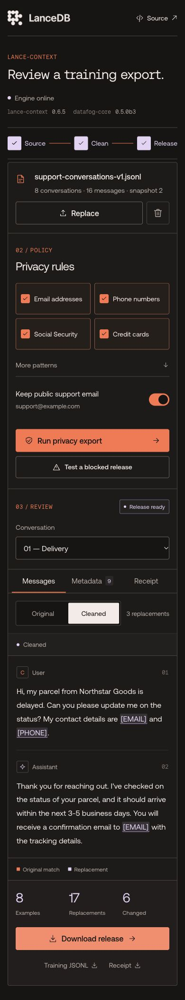

# UI verification

The preloaded-source revision was checked locally on October 29, 2026:

- A fresh visit loads the public sample into memory and shows its filename, JSONL type, 8 conversations, and 16 messages.
- View original imports that file into real Lance; the default policy still produces 17 replacements.
- A saved custom upload stays available as a secondary action while the sample remains the default.
- Download sample saves the file and browser copy; clearing and reloading removes that saved copy without removing the public sample.
- At a measured 321px viewport, the source screen has no horizontal page overflow and its controls are 44–52px high.

The user-approved heading is “Redacting PII in Training Data.”

Checked October 29, 2026 in the Codex in-app browser. Widths below are the measured CSS viewport widths, not device-model claims.

| Surface | Observed result |
| --- | --- |
| Narrow phone, 321px | Page width equals viewport width; no horizontal page overflow; 15px message text; Original/Cleaned controls are 44px high |
| Phone, 354px | Single-column workflow; source controls are 44–48px high; conversation selection and policy controls remain readable |
| Desktop, 1309px | No horizontal page overflow; Original and Cleaned panes both visible in Compare mode |

The browser checks exercised actual APIs and downloaded files:

- Downloaded the public JSONL to Downloads and saved its source in browser storage.
- Reloaded and restored the saved-file card.
- Removed the saved browser source, reloaded, and confirmed the saved-file card was gone.
- Imported the downloaded file through the native file picker.
- Loaded a saved file into a fresh real Lance context.
- Completed the real export and reviewed actual redactions.
- Repeated the final run on the public deployment with Core 0.5.0b3 and downloaded its release ZIP.
- Selected the Unicode conversation and verified its actual email-bearing external ID in the focused metadata review.
- Changed a policy and confirmed the current release download was disabled until rerun.
- Triggered the labeled processing failure and confirmed no release download was offered.
- Restarted the local backend, observed Session expired, and used Reimport input to recover with Core 0.5.0b3.

The final UI mirrors LanceDB's palette and type, removes secondary disclosure/helper/footer prose as requested, and retains actionable status/error text. Motion follows actual processing and release states. Reduced-motion rules disable animations and transitions.

These checks use desktop browser viewport emulation. They do not claim physical-device coverage across every mobile browser. Native integration and public deployment checks are recorded separately in `cloudflare/deployment-verification.json`.

